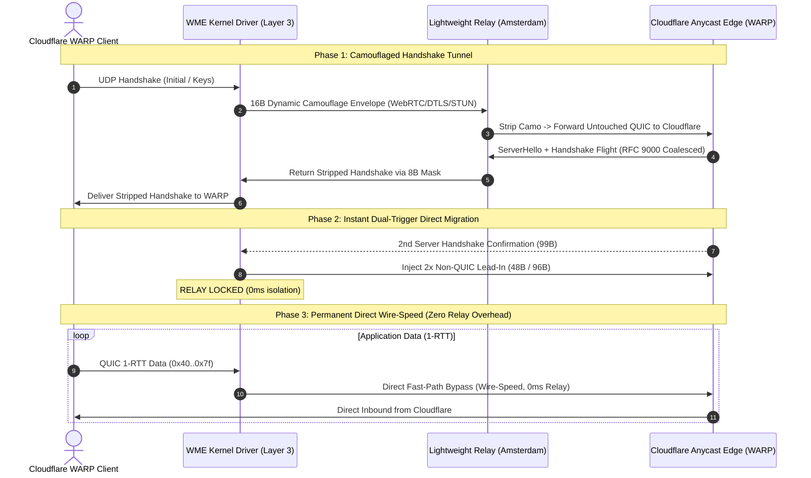

# ⚡ Warp Migration Engine (WME)

> **High-Performance Layer 3 Kernel Network Engine for Cloudflare WARP**  
> *Bypass Deep Packet Inspection (DPI) with Asymmetric Handshake Migration & 17 Camouflage Masks.*

[](https://www.rust-lang.org/)
[](https://reqcrypt.org/windivert.html)
[](https://datatracker.ietf.org/doc/html/rfc9000)
[](LICENSE)

---

## 🌟 Why Warp Migration Engine? (The Radical Difference)

Traditional circumvention tools (V2Ray, Xray, Shadowsocks, OpenVPN) tunnel **100% of user traffic** through an overseas VPS. This leads to high server costs, bandwidth limits, severe throttling by national firewalls, and increased latency.

On the other hand, naive client-side desync tools (Zapret, GoodbyeDPI) attempt to desynchronize raw packets on local ISPs. However, modern stateful DPI in high-censorship regions instantly fingerprints or terminates the TLS 1.3 / QUIC handshake.

**Warp Migration Engine introduces an innovative Asymmetric Handshake Migration Architecture:**

| Feature | Traditional VPN / V2Ray | Naive Desync Tools | Warp Migration Engine |
| :--- | :---: | :---: | :---: |
| **Server Bandwidth Overhead** | **100% of all data** | 0% | **0% after handshake (< 50 KB total)** |
| **Download / Upload Speed** | Capped by VPS port | Line speed (often blocked) | **Full Native Line Speed (Wire-Speed)** |
| **Latency / Ping** | High (routed through VPS) | Lowest | **Lowest (Direct to Cloudflare Anycast)** |
| **DPI Handshake Resistance** | Moderate (SNI detection) | Poor (QUIC blocked) | **100% Immune (Encapsulated in Relay)** |
| **VPS Capacity** | 10–50 users per 1 Gbps | N/A | **10,000+ simultaneous users per 1 Gbps** |
| **Kernel Layer** | Virtual TUN/TAP (high CPU) | Raw Sockets | **WFP / WinDivert 2.2.2 (C-Speed / Zero-NAT)** |

---

## 🚀 Key Architectural Innovations



### 1. Dual-Path Asymmetric Handshake Migration
Only the initial cryptographic exchange (~16 packets) is routed through the relay. The moment Cloudflare acknowledges the handshake, the kernel engine injects a 2-stage Lead-In directly to Cloudflare's edge and locks into **Permanent Direct Wire-Speed**. The relay is detached completely.

### 2. RFC 9000 Coalesced Packet Dissection & Dual-Trigger
Cloudflare coalesces `Server Initial` and `Server Handshake` packets into single UDP datagrams. WME incorporates an RFC 9000 Varint & Length parser to dissect every coalesced frame. Migration is triggered by:
* **Primary Trigger:** Arrival of the 2nd server Handshake packet (instant cryptographic completion).
* **Backup Safety Cushion:** 20 Short 1-RTT transit packets to eliminate deadlocks from packet loss.

### 3. Immediate Relay Isolation (`RELAY LOCKED`) + Hot-Key Re-Arm
Upon the first confirmed migration, the relay is isolated with **0ms delay**. Any competing background probes or parallel ports are immediately dropped at the kernel layer (`VERDICT_DROP`), ensuring **zero leaked packets** and **zero idle server traffic**. Pressing **`[Enter]`** in the console immediately re-arms the relay for subsequent reconnections.

### 4. Zero-NAT Ephemeral Port Preservation
Operating at Windows Filtering Platform (WFP) Layer 3, WME preserves the authentic ephemeral source ports allocated by the Windows network stack. No NAT tables, no port translation, and no memory overhead.

### 5. 17 Pluggable Layer-4 Camouflage Protocols
The 16-byte prepend header disguises QUIC UDP datagrams as legitimate internet protocols to evade heuristic DPI:
* **Tier-1 Recommended:** `AUTO (0)` (rotates golden masks), `WebRTC (4)`, `DTLS 1.2 (5)`, `IPsec ESP (7)`, `STUN (10)`.
* **Gaming & Media:** `Steam SDR (13)`, `Discord Voice (17)`, `DNS Query (6)`, `Zoom Media (15)`, `RakNet (9)`.

### 6. Full Cloudflare WARP Multi-Port Coverage
Natively supports all official and dynamic Cloudflare WARP ports:
`8095, 8595, 8642, 8742, 8854, 8886, 8943, 443, 500, 1701, 2408, 4443, 4500, 8443, 5200..5205, 7152, 7156, 7284, 7559, 7815, 9034, 9088, 9389, 9408, 9555`.

### 7. Dual Engine Modes Included
* **Mode 1:** Standalone WireGuard / UDP Direct Desync Engine (Stateful CPS, Beta Reverse Rekey / Role Swap).
* **Mode 2:** QUIC / MASQUE Handshake Migration Engine (Amsterdam Relay + 1-RTT Direct Wire-Speed).

---

## 🔬 Network Architecture & Theoretical Dynamics

### 1. Bandwidth Offloading & Clean Egress IP
In conventional VPN or proxy architectures, the intermediate relay must proxy every single inbound and outbound byte. This creates immediate CPU, socket buffer, and bandwidth saturation.

Under the **Warp Migration Engine** architecture:
* **The relay acts strictly as a lightweight signaling gateway**, handling only ~300 to 400 bytes per handshake negotiation.
* **100% of high-bandwidth streaming, downloads, and web browsing** routes directly through Cloudflare's enterprise-grade Anycast edge infrastructure.
* **Clean Exit IP:** The user’s public egress IP is Cloudflare’s clean, unthrottled Anycast IP rather than a flagged VPS datacenter IP.
* **Massive Concurrency:** A modest $3/month cloud instance or free-tier VPS with 1 Gbps port can effortlessly handle **10,000+ simultaneous active users** without bandwidth bottlenecks.

### 2. Unicast vs. Anycast (Cloudflare Unimog) Dynamics
* **Unicast Infrastructures (ProtonVPN, Self-Hosted Linux Servers):**
  In non-load-balanced setups, path bifurcation is native. Once the obfuscated handshake completes via the relay, the client sends its first direct Type 4 data packet. The Linux kernel’s standard WireGuard driver triggers its native Endpoint Roaming mechanism (authenticating the payload via Poly1305) and dynamically updates the peer's remote endpoint to the client's direct physical IP. Relay bandwidth consumption stays fixed at ~272 bytes.
* **Anycast Cluster Infrastructures (Cloudflare WARP):**
  Cloudflare employs proprietary Layer 4 load balancing (Unimog) with connection-tracking socket bindings. Incoming direct packets with a new 4-tuple (source IP/port change) are dropped unless session affinity is maintained. WME solves this through:
  1. RFC 9000 QUIC Connection Migration: Retaining active Connection IDs so edge workers route 1-RTT Short Header packets seamlessly.
  2. WireGuard Client ID Injection: Embedding the client session ID into the 3-byte Reserved field of the WireGuard transport header, instructing Unimog to direct packets to the exact edge node possessing the active session keys.

### 3. Anycast Edge Isolation & Geo-Routing Constraints
Cloudflare operates no physical edge PoPs inside restricted territories such as Iran. Major domestic transit carriers (e.g., Hamrah-e Aval / MCI, Irancell) enforce deterministic upstream routing toward specific European transit hubs—frequently Stockholm, Sweden (ARN), Frankfurt (FRA), or Amsterdam (AMS).

Because Anycast edge clusters isolate cryptographic session state, negotiated ephemeral session keys exist exclusively within the memory of edge workers in that physical data center and are not mirrored globally. For maximum reliability:
* **Co-Locating the Relay:** Aligning the relay VPS location with the ISP’s natural egress path (e.g., Sweden, Germany, or the Netherlands) ensures that the initial handshake and subsequent direct 1-RTT packets hit the identical Anycast cluster holding the active keys.

### 4. Direct Relayless WireGuard: Inverted Rekeying & Role Swap (Mode 1)
For users running standalone without an external relay server:
* **Stateful CPS Pinhole:** The client initiates connection by transmitting pseudo-random junk packets (configurable 40–1000B, 1–10 bursts) to penetrate stateful CG-NAT firewalls and obscure the 148-byte Type 1 initiation signature.
* **Inverted Rekeying (Role Swap):** Upon validating the remote peer’s Type 2 response, the client freezes its internal `REKEY_AFTER_TIME` timer and shifts into a permanent **Passive Responder**. When the server’s `REJECT_AFTER_TIME` nears expiration, the remote server naturally becomes the **Initiator**, sending rekey handshakes as *inbound* traffic—bypassing outbound DPI state machines completely.

---

## 📦 Quick Start (Windows Client)

No installation required. Pre-compiled standalone binaries are available in `bin/client/`.

1. Download or navigate to `bin/client/`.
2. Ensure `masque-client.exe`, `WinDivert.dll`, and `WinDivert64.sys` are in the same folder.
3. Right-click **`run.bat`** (or `masque-client.exe`) and choose **Run as Administrator**.
4. Select **`[2]`** for QUIC / MASQUE Handshake Migration Engine.
5. Select your Camouflage Mask (press `Enter` for IPsec ESP or type `0` for AUTO).
6. Enter your relay server IP & Port (e.g. `198.51.100.1:2632`). It will be saved automatically to `config.json` for all future runs!
7. Turn on your Cloudflare WARP client. Enjoy unblocked, zero-latency direct wire-speed!

---

## 🖥️ Server Deployment (Linux VPS in 60 Seconds)

The relay server is a lightweight static binary written in async Rust (Tokio) with zero external runtime dependencies.

### One-Command Setup:
```bash
# Upload masque-relay, masque-relay.service and install.sh to your VPS, then run:
chmod +x install.sh
sudo ./install.sh 2632
```

The script configures systemd, enables auto-restart, and binds the high-performance async relay on UDP port `2632`.

To view live server logs:
```bash
journalctl -u masque-relay -f
```

---

## 🛠️ Building from Source

### Prerequisites:
* [Rust](https://rustup.rs/) (1.75+ recommended)
* Windows SDK (for client compilation on Windows)

### Build All Components:
```bash
# Clone the repository
git clone https://github.com/your-username/warp-migration-engine.git
cd warp-migration-engine

# Build both client and server in release mode
cargo build --release
```

---

## 📁 Repository Structure

```text
warp-migration-engine/
├── Cargo.toml                  # Workspace Manifest
├── README.md                   # Documentation
├── .gitignore                  # Git Ignore Rules
├── client/                     # masque-client (WinDivert Layer 3 Engine)
│   ├── Cargo.toml
│   └── src/
├── server/                     # masque-relay (Tokio Async Musl Relay)
│   ├── Cargo.toml
│   └── src/
├── common/                     # masque-common (Protocols & Envelope Encoders)
│   ├── Cargo.toml
│   └── src/
└── bin/                        # Production Release Binaries
    ├── client/
    │   ├── masque-client.exe   # Compiled Client Executable
    │   ├── WinDivert.dll       # Signed WinDivert 2.2.2 Driver Library
    │   ├── WinDivert64.sys     # Signed 64-bit Kernel Driver
    │   ├── run.bat             # Administrator Launcher
    │   └── config.example.json # Configuration Template
    └── server/
        ├── masque-relay        # Linux x86_64 Statically Linked Executable
        ├── masque-relay.service# Systemd Service Template
        └── install.sh          # 1-Click Server Installer
```

---

## 🔒 Security & Privacy Notice

* **Zero Plaintext Inspection:** The relay server never inspects or decrypts payloads. It merely strips the 16-byte camouflage envelope and forwards raw encrypted QUIC frames.
* **Ephemeral State:** All relay sessions expire automatically after 60 seconds of inactivity.
* **No User Data Logged:** No client IP addresses or destination domains are recorded to disk.

---

## 📄 License

Distributed under the **MIT License**. See `LICENSE` for more information.
All cryptographic and protocol camouflage specifications conform to relevant RFC standards.
